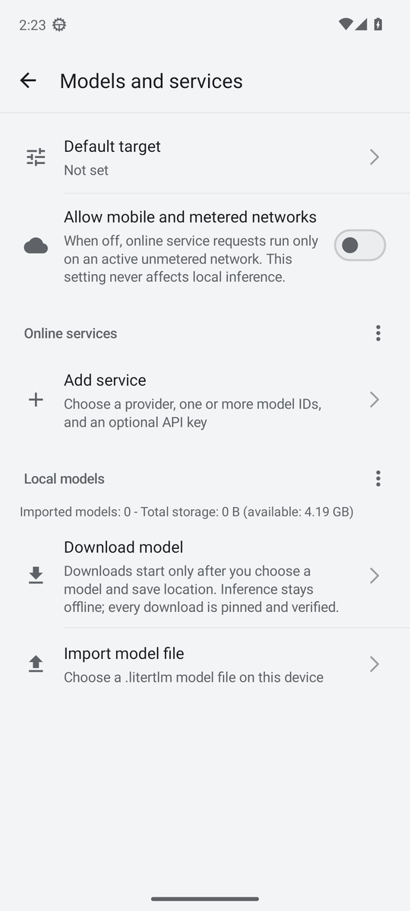
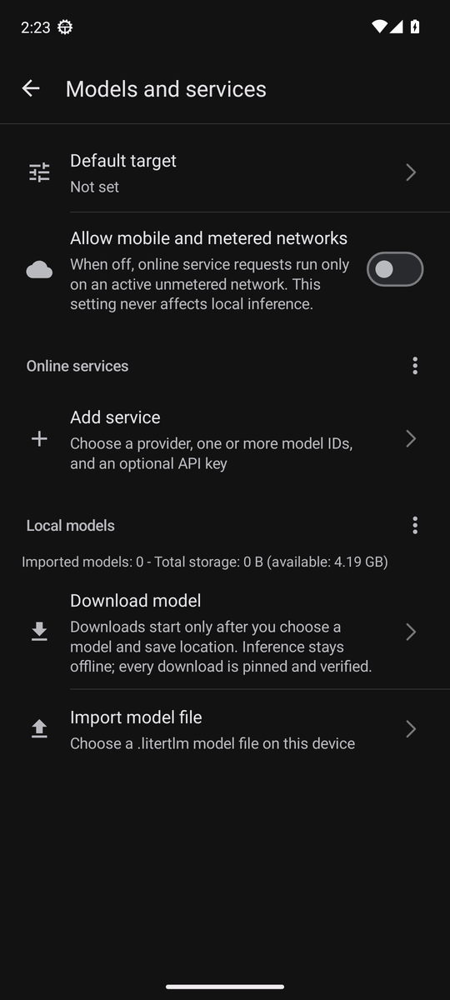

# Settings tree, "Models and services" and the single default target (2026-11-13)

3-Stone AI 1.7.0 development build 327, roadmap 1.6.0 P5a (P5.1 - P5.3; D80, D95, D97, D98, D100, D104, D110 - D120). No release, VERSION_NAME stays 1.6.0 until the 1.7.0 release card.

## Scope

- P5.1 (c190336): the settings home keeps the appearance rows and five entries (Conversation, Models and services, Voice, Privacy and permissions, Updates and about); each title appears in one place only; the chat menu and drawer keep one "Settings" entry; the host settings action lands on "Models and services" above the settings home.
- P5.2: the former "Models" and "Online services" pages are one page, ModelManagerActivity extending the abstract OnlineServicesActivity (D115). Default target and metered network rows on top, then the "Online services" and "Local models" sections with the same cards, badges, item menus and section menus (D116 - D120). OnlineAiSettingsActivity is no longer declared in the Manifest.
- P5.3: one global default target stored in `files/ai-default-target/default-target` (D114). The first catalog read migrates the previous effective default once and only creates that file; `defaultProfileId`, `selectedModelId` and every other preference stay unchanged, so downgrading to 1.6.x restores the old behavior. An unavailable or deleted default falls back to the automatic choice while the stored value is kept.

## Verification

- JVM: `testDebugUnitTest` 609 tests, no failures (DefaultTargetTest 15 cases: four migration cases, unavailable and deleted fallback, corrupt file, concurrent writers, rename failure). `assembleDebug`, `assembleDebugAndroidTest` and `lintDebug` succeed; lint reports no new issue.
- Repository scripts: `check_settings_titles.py` PASS (10 pages, 10 locales, 0 problems; the checker now adds a subclass without its own page title to its base page, covered by a fifth rule case); `python -m unittest discover -s .python` 69 tests OK; `generate_markdown.py --check` passed; `git diff --check` clean.
- AVD_API_33 (x86_64, read-only instance, debug and androidTest build 326 with the same sources): the whole instrumentation suite, 91 tests. 79 passed, 8 skipped by assumptions (real LiteRT model, online API key, launcher state requests), 3 manual speech tests not run, 0 failures. SettingsNavigationTest 5 / 5 covers the five entries, the renamed output section, the version history location, the host action landing with Back to the settings home, and the new page order (default target, metered network, online services, add service, local models, download, import; each once). OnlineAiProfileEditorDeviceTest now opens ModelManagerActivity. SpeechReadingDeviceTest.repliesAreReadWhileTheyStream timed out once on the first run after the previous run was stopped, then passed in three reruns (single test twice, whole class after a cold start).
- Screenshots: `.python/device_settings_screenshots.py --serial <serial>` installs the debug and androidTest APKs over the existing app, runs ModelsAndServicesScreenshotTest with `-e screenshots true` (skipped otherwise), switches only the plugin's own dark mode, writes the appearance preferences back and uninstalls the test APK. Reference run on AVD_API_33: PASS, 4 screenshots; light and dark tops reduced to 540 px wide in `p5a-settings-evidence/`.

## Not yet covered

- XQ-DQ72 (QV770340J7) light and dark screenshots with the maintainer's real services and models, and the migration check on that device (the default target row and `run-as` reading of the stored target after the first install). The remote adb server was unreachable during this run, and the first install of the migrating debug build waits for the maintainer's consent.
- Host side: AutoJs6 `AiProviderTargetListingAndroidConformanceTest` still expects the radio button selection on the local model list that P5.3 removed; it belongs to the host repository and is left for the host.
