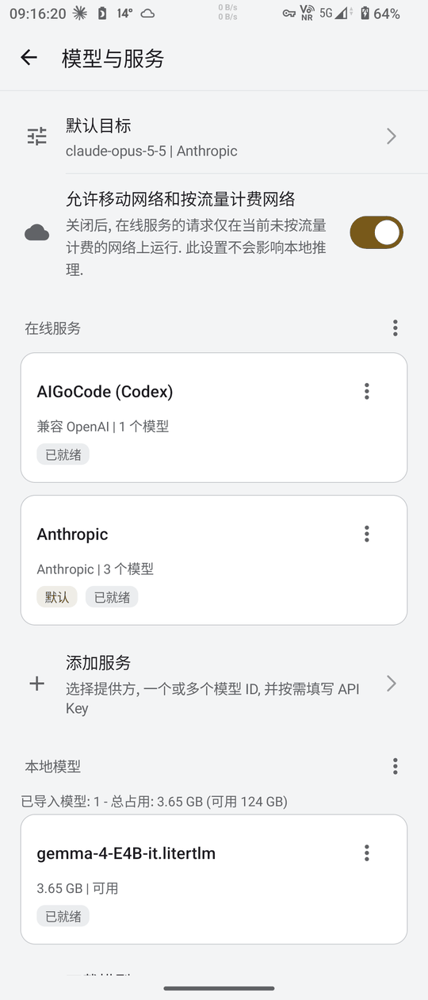
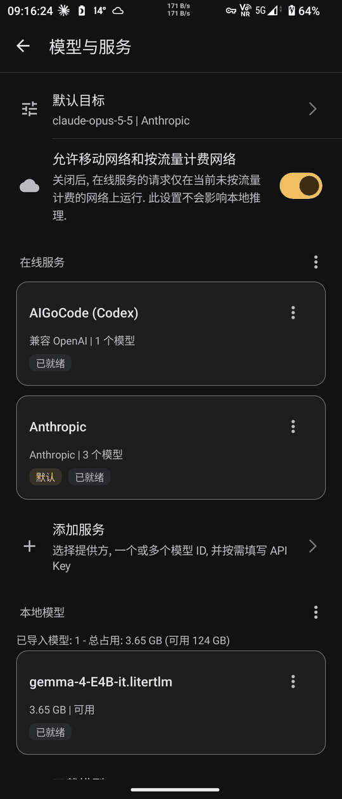

# Settings tree, "Models and services" and the single default target (2026-11-13)

3-Stone AI 1.7.0 development build 327, roadmap 1.6.0 P5a (P5.1 - P5.3; D80, D95, D97, D98, D100, D104, D110 - D120). No release, VERSION_NAME stays 1.6.0 until the 1.7.0 release card.

## Scope

- P5.1 (c190336): the settings home keeps the appearance rows and five entries (Conversation, Models and services, Voice, Privacy and permissions, Updates and about); each title appears in one place only; the chat menu and drawer keep one "Settings" entry; the host settings action lands on "Models and services" above the settings home.
- P5.2: the former "Models" and "Online services" pages are one page, ModelManagerActivity extending the abstract OnlineServicesActivity (D115). Default target and metered network rows on top, then the "Online services" and "Local models" sections with the same cards, badges, item menus and section menus (D116 - D120). OnlineAiSettingsActivity is no longer declared in the Manifest.
- P5.3: one global default target stored in `files/ai-default-target/default-target` (D114). The first catalog read migrates the previous effective default once and only creates that file; `defaultProfileId`, `selectedModelId` and every other preference stay unchanged, so downgrading to 1.6.x restores the old behavior. An unavailable or deleted default falls back to the automatic choice while the stored value is kept.

## Verification

- JVM: `testDebugUnitTest` 609 tests, no failures (DefaultTargetTest 15 cases: four migration cases, unavailable and deleted fallback, corrupt file, concurrent writers, rename failure). `assembleDebug`, `assembleDebugAndroidTest` and `lintDebug` succeed; lint reports no new issue.
- Repository scripts: `check_settings_titles.py` PASS (10 pages, 10 locales, 0 problems; the checker now adds a subclass without its own page title to its base page, covered by a fifth rule case); `python -m unittest discover -s .python` 69 tests OK; `generate_markdown.py --check` passed; `git diff --check` clean.
- AVD_API_33 (x86_64, read-only instance, debug and androidTest build 326 with the same sources): the whole instrumentation suite, 91 tests. 79 passed, 8 skipped by assumptions (real LiteRT model, online API key, launcher state requests), 3 manual speech tests not run, 0 failures. SettingsNavigationTest 5 / 5 covers the five entries, the renamed output section, the version history location, the host action landing with Back to the settings home, and the new page order (default target, metered network, online services, add service, local models, download, import; each once). OnlineAiProfileEditorDeviceTest now opens ModelManagerActivity. SpeechReadingDeviceTest.repliesAreReadWhileTheyStream timed out once on the first run after the previous run was stopped, then passed in three reruns (single test twice, whole class after a cold start).
- Screenshots: `.python/device_settings_screenshots.py --serial <serial>` installs the debug and androidTest APKs over the existing app, runs ModelsAndServicesScreenshotTest with `-e screenshots true` (skipped otherwise), switches only the plugin's own dark mode, writes the appearance preferences back and uninstalls the test APK. Reference run on AVD_API_33: PASS, 4 screenshots; light and dark tops reduced to 540 px wide in `p5a-settings-evidence/`.

## XQ-DQ72 (QV770340J7, 2026-11-13 08:2x)

- The maintainer agreed at 08:1x (through the dispatch session) to install the migrating debug build over the release build 320. Debug build 328 (same sources as c325e6c) was installed with data kept; nothing was uninstalled.
- Migration, `device_settings_screenshots.py --migration-check`: PASS. Before the first launch the default target file did not exist; afterwards it holds `v1` and the previous default service (the first model of the service named by `defaultProfileId`). `ai-profiles/profiles.json` and `models/catalog.json` were not written after the install (modification time older than the install, same digest before and after the run). The check prints only these verdicts, no content, ID or digest.
- Screenshots: the first run failed at "Both sections are shown". The expected labels came from the test process, which uses the system language (en-US), while the plugin follows the AutoJs6 language; the test now reads the labels from the Activity and lists the missing ones. The device then dropped off the remote adb server and did not return within 15 minutes.
- Screenshots, second run (09:1x, after the device came back), `device_settings_screenshots.py --serial QV770340J7 --no-install` with the debug build 328 and the androidTest APK already on the device: PASS, 4 screenshots (light and dark, page top and scrolled to the local section); the androidTest APK was uninstalled at the end and debug build 328 stays installed. The page follows the AutoJs6 language (Simplified Chinese). From the top: the default target row, the metered network row, the online services section (two service cards and "Add service"), the local models section (one model card); each appears once. The default target row shows the first model of the previous default service, the same target the migration check found, and only that service card carries the "Default" badge. No API key or token is visible. Light and dark tops reduced to 540 px wide:

## Not yet covered

- Host side: AutoJs6 `AiProviderTargetListingAndroidConformanceTest` still expects the radio button selection on the local model list that P5.3 removed; the dispatch session scheduled it as a separate host card (Q23 = A, D121, P9.0).
