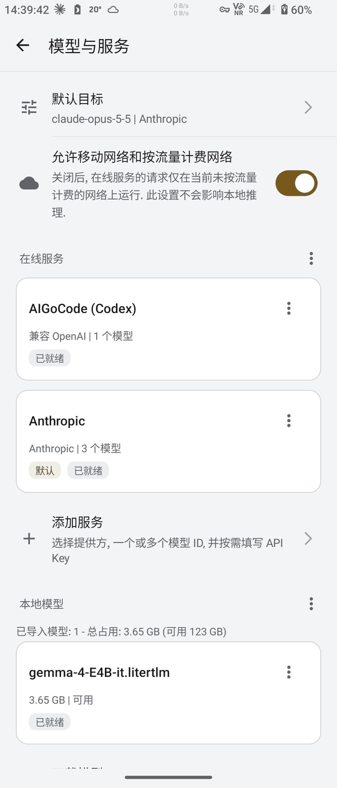
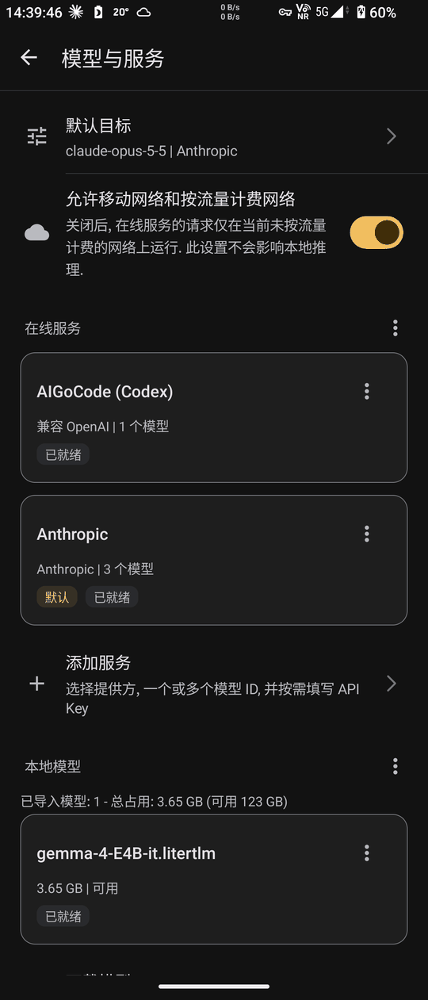

# Service details, one-step download and the switcher panel on XQ-DQ72 (2026-11-13)

3-Stone AI 1.7.0 development build 336 (sources of 4c5f166), roadmap 1.6.0 P5b (P5.4 - P5.7; D96, D99, D101, D107, D122 - D130). No release, VERSION_NAME stays 1.6.0 until the 1.7.0 release card. The emulator and JVM results of P5.4 - P5.7 are recorded in ROADMAP.md next to each item; this page covers the real device part of P5.7.

## Device and consent

- XQ-DQ72 (QV770340J7, Android 13, arm64-v8a) through the remote adb server, with the maintainer's own data: two online services, one imported local model (gemma-4-E4B-it, 3.65 GB) and the default target on the Anthropic service.
- The maintainer agreed on 2026-11-13 13:0x (in this session and through the dispatch session) to (a) install debug build 336 over debug build 328 with data kept, and (b) download Qwen2.5 1.5B Instruct (1.49 GiB) once and delete it afterwards. The device was offline at first and came back at 14:1x; nothing was uninstalled.
- The phone was on mobile data (5G, Wi-Fi enabled but not connected) during the run, so the download used mobile traffic.

## Upgrade from 328 to 336

- Before the install (14:12) a scratch script recorded, through run-as, the digests of the default target file, `ai-profiles/profiles.json`, `models/catalog.json` and the nine preference files, plus the names and sizes in `files/models`. After the install and the first launch (the screenshot run, 14:20) every item was byte-identical: no preference key was removed or rewritten, the imported model and its catalog were untouched, and no `.download-*.part` file existed.
- `device_settings_screenshots.py --migration-check`: PASS. The default target file keeps `v1` and the first model of the service named by `defaultProfileId`; the two documents were not written after the install.
- The four screenshots of that run passed but a heads-up notification covered the top of the page, so they were taken again after the flows (below).

## Flows, `device_models_flow.py --no-install --real-request --download` (14:2x)

ModelsAndServicesRealDeviceFlowTest (D130), 3 / 3 PASS; the androidTest APK was uninstalled at the end.

- Service flow: on the service details page a test service (address `https://p57-flow.invalid/v1`, placeholder key, no keyboard input) got two typed models and was saved; on "Models and services" the "Default target" row chose its second model; a new conversation used that target with no message sent. The test service was deleted afterwards.
- Real request: the existing service with gpt-6.1-sol (AIGoCode (Codex)) was made the default from the page and answered one short prompt in a new conversation (status complete, 2 characters, reply target = that default). One request; no Anthropic request; no key was read or printed.
- One-step download: from the page, "Download model" -> Qwen2.5 1.5B Instruct -> "Download" -> confirm. The download went through CONNECTING and DOWNLOADING (0%, 29%, 58%, 88% at one-minute marks), verified the fixed size and SHA-256 and imported the model in 3.4 minutes (1,597,931,520 bytes, file length equal, no partial file left, the existing model still listed). The test then deleted only that model and put the selected local model back.
- Each test restores the default target, the favorites, the base URL history, the token calibration and the remembered conversation; the chat test environment deletes the conversations created during the test (by ID difference). The script compared these states before and after: default target, services (2), local models (1, selected set) and the four preference files were the same.
- Byte-level comparison with the snapshot taken before the upgrade, after all runs: the default target file, the model directory and eight preference files are byte-identical. `profiles.json` and `catalog.json` were rewritten with a higher revision (adding and deleting the test service, importing and deleting the downloaded model) with the same services, entries and selection; the second migration check confirms that `defaultProfileId` still names the original default service. `app-update-settings.xml` holds only `last-automatic-attempt`, written by the app's own 12-hour update check when the chat page opened.

## Screenshots (14:39)

`device_settings_screenshots.py --migration-check` again after the flows: PASS, 4 screenshots, migration check PASS. From the top: the default target row (claude-opus-5-5 | Anthropic), the metered network row, the online services section (two service cards, only the default service carries the "Default" badge, then "Add service"), the local models section (one model card, 3.65 GB). The test service and the downloaded model are gone. No API key or token is visible. Light and dark tops reduced to 540 px wide:

## State left on the device

- 3-Stone AI debug build 336 stays installed with the maintainer's data; the androidTest APK is uninstalled (package count 0); no partial download, no screenshot directory left on shared storage.
- The script does not count stored conversations; it relies on the test environment's deletion by ID difference and on the unchanged remembered conversation.
